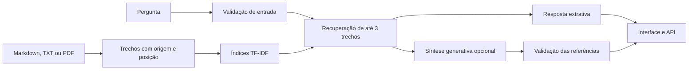

# Arquitetura e validação



## Ingestão e recuperação

Markdown é segmentado por títulos; texto e PDF são divididos em trechos limitados por tamanho. PDFs preservam a página. Arquivos textuais preservam a faixa de linhas. O identificador é derivado de arquivo, posição, seção e conteúdo.

O ranking combina similaridade TF-IDF de palavras (peso 0,8) e sequências de caracteres (peso 0,2). Algumas variações frequentes do domínio são expandidas por um dicionário explícito, como devolver/devolução e rastrear/rastreamento. O filtro mínimo de relevância é 0,14, com cobertura mínima de 20% dos termos de consulta expandidos no trecho.

O escore indica relevância lexical, não confiança calibrada nem probabilidade de resposta correta. Esse método não usa embeddings semânticos e pode falhar em paráfrases distantes do vocabulário da base.

## Resposta e citações

No modo extrativo, a aplicação reproduz os trechos recuperados. O status evidence_found significa que há evidência textual relacionada; não garante que todos os detalhes da pergunta estejam respondidos.

No modo generativo, a pergunta e até três trechos são enviados à Responses API com instruções para usar exclusivamente as evidências. A saída estruturada contém answer, answerable e citations. Identificadores ausentes, citações inexistentes e divergências entre marcadores no texto e lista de fontes invalidam a resposta.

A verificação de identificadores confirma a origem citada, mas não verifica automaticamente se toda afirmação é sustentada pelo conteúdo. A avaliação semântica das respostas do modelo é uma dimensão distinta dos testes de contrato.

## Dados e processamento

- A base de demonstração contém documentos fictícios e públicos no repositório.
- Documentos enviados pelo painel são mantidos na memória da sessão e substituem a base demonstrativa nas consultas.
- A aplicação não grava uploads nem histórico de perguntas em arquivos.
- O modo local não envia documentos a um provedor externo.
- A síntese externa exige autorização no formulário ou na chamada da API e usa store=False; as políticas de retenção do provedor continuam aplicáveis.
- A detecção de alguns formatos de CPF/cartão e de consultas a pedidos é uma camada de entrada, não um detector universal de dados pessoais.
- A instrução de tratar pergunta e documentos como dados não confiáveis reduz risco de injeção de prompt, mas não garante eliminação de ataques.

## Limites operacionais

Até cinco documentos por sessão, 2 MB por arquivo, 30 páginas por PDF e no máximo 300.000 caracteres ou 600 trechos por base. PDFs precisam conter texto selecionável; OCR não faz parte desta implementação.

A API usa a base demonstrativa do servidor e não inclui autenticação de usuários. A publicação externa deve adicionar autenticação, limites de tráfego e gerenciamento de segredos. Os comandos do README mantêm o serviço restrito ao computador local.

## Avaliação reproduzível

```bash
python -m pytest -q
python -m atendedoc evaluate
```

O relatório detalha os 28 casos de referência. Recuperação de fonte @3 mede a presença da seção esperada entre até três fontes. A taxa de critérios atendidos combina esse resultado com o status esperado. São métricas do cenário demonstrativo, sem inferência de generalização para outras empresas ou bases.

Referência para a integração: [documentação oficial de saídas estruturadas](https://developers.openai.com/api/docs/guides/structured-outputs).
